# 🌌 AstroHub: Universe Portal

A **full-stack web app** inspired by the **universe and space exploration**, built as the final project of the full-stack web programming course at Master.D.
I built it from scratch with **HTML5, CSS3, JavaScript, PHP and MySQL**. AstroHub combines a clean design with a working back end that manages users, news and astronomy appointments.

The site was developed and tested **locally with XAMPP**, and includes both the public site and the internal user and admin panels.

Visitors and registered users can:

- Sign up and log in with their own credentials.
- Read **news about the universe** published by administrators.
- View and edit their **personal profile**.
- Request, edit or cancel **astronomy appointments** (events, talks or consultations).
- **Administrators only:** manage users, news and appointments from an admin panel.

AstroHub is designed as an educational and management portal for **science outreach centres**, **astronomy communities** or **space enthusiasts** who want to centralise information and participation.

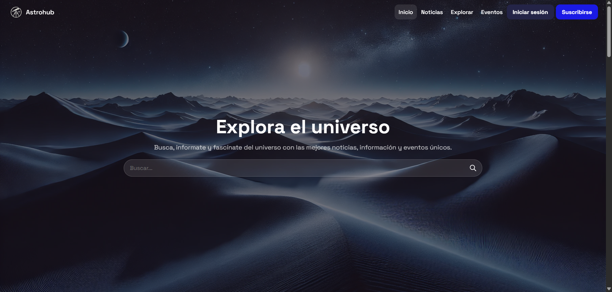

---

## Table of contents 🧭

- [Demo](#demo-)
- [Features](#features-)
- [Installation](#installation-)
- [Usage](#usage-)
- [Project structure](#project-structure-)
- [Tech stack](#tech-stack-)
- [Licence](#licence-)
- [Contact](#contact-)

---

## Demo 💯

The site runs locally with XAMPP at `http://localhost/astrohub/`.

<details>
<summary><b>Screenshots</b></summary>


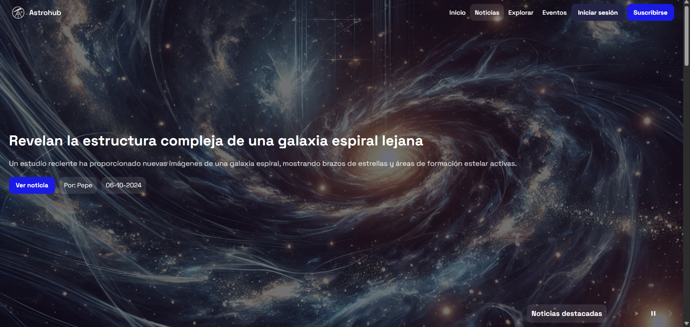
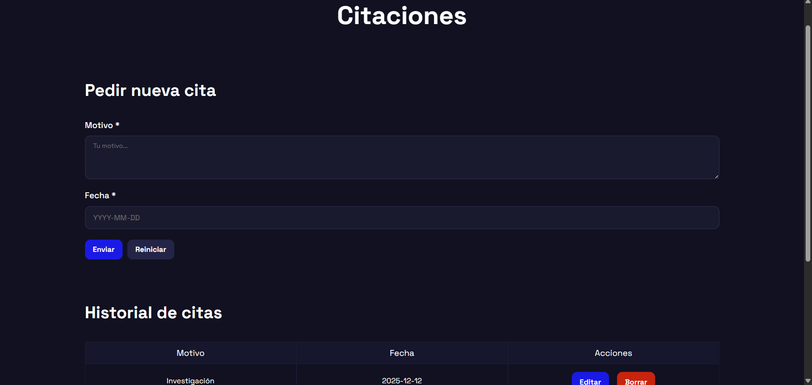
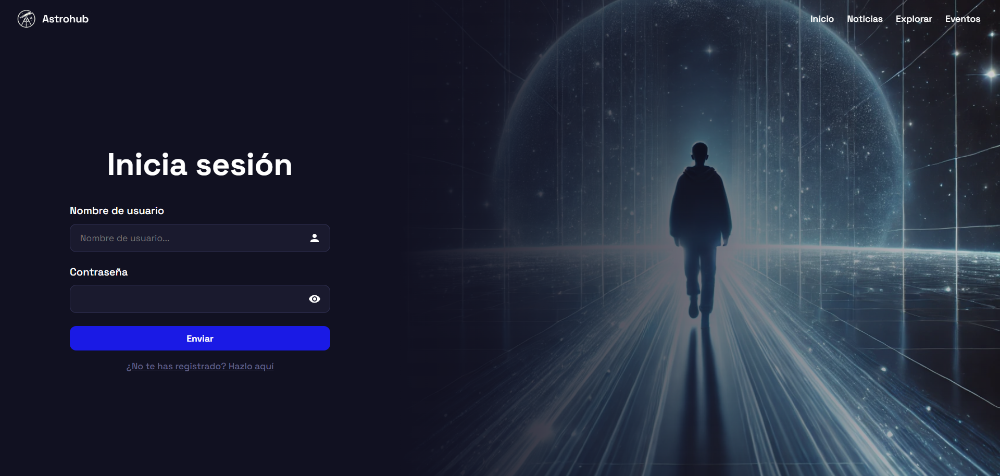
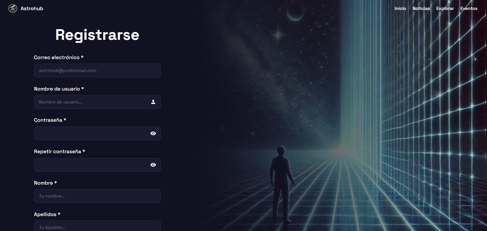
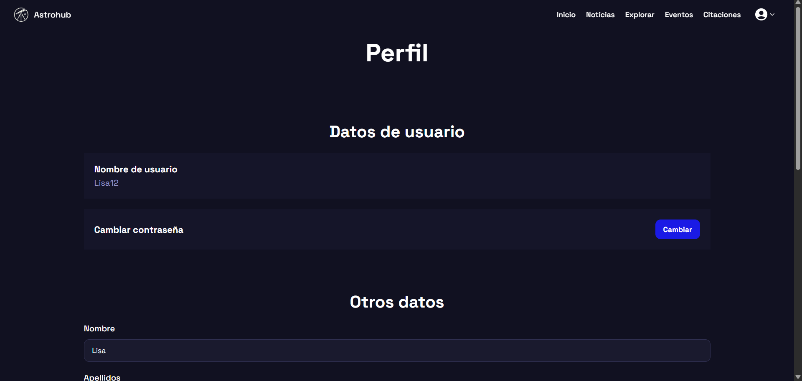
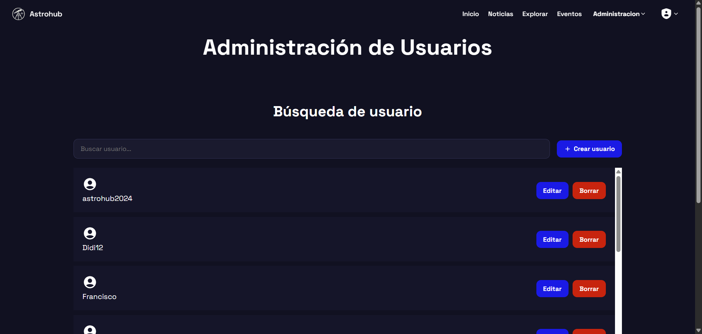
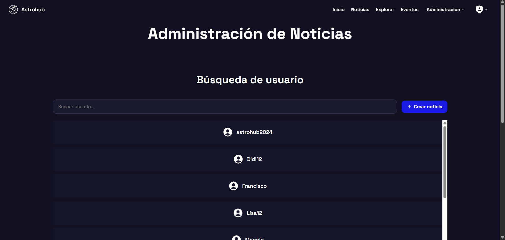
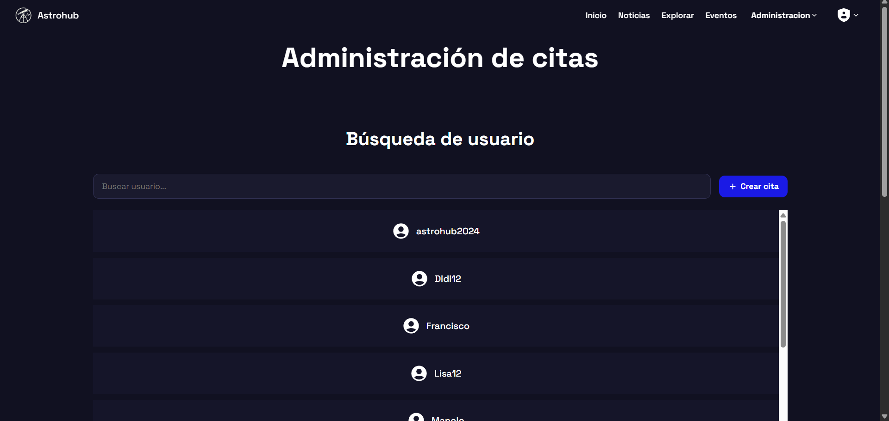
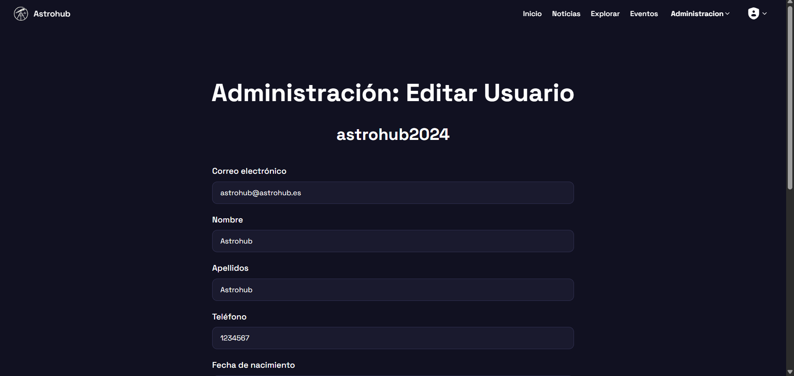
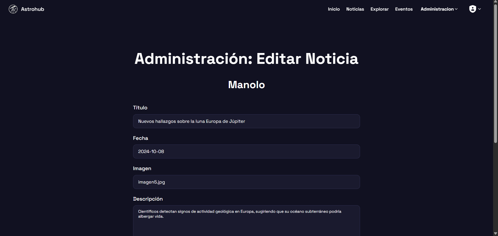
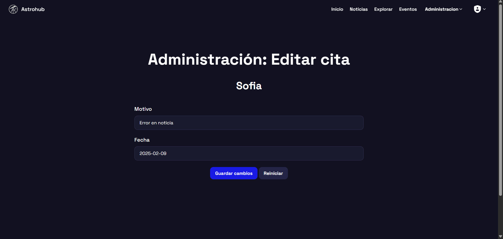

</details>

> The interface is in Spanish.

---

## Features 🚀

- **Sign-up and login.**
- **Three roles:** visitor, user and administrator.
- **Management** of news, appointments and personal profiles.
- **Admin panel** to create, edit and delete users, appointments and news (full CRUD).
- **Form validation** and **hashed passwords**.
- **Navigation bar** that adapts to the user's role.
- **Clean, structured design** with HTML5, CSS3 and PHP.

---

## Installation 🛠️

1. Install **XAMPP** (or any stack with Apache, PHP and MySQL).
2. Copy the `astrohub` project folder into XAMPP's `htdocs` directory.
3. Start **Apache** and **MySQL** from the XAMPP control panel.
4. Create a database in **phpMyAdmin** and **import** the `astrohub.sql` file included in the project.
5. Open your browser at http://localhost/astrohub/

---

## Usage 👤

### Test accounts

| Role | Username | Password |
|---|---|---|
| User | `lisa12` | `123456` |
| Administrator | `root` | `1234567` |

> ⚠️ These credentials are **only for testing the app**. They are unrelated to the MySQL server credentials.

### Roles and access

- **Visitor:** home, news, sign-up and login.
- **User:** profile and appointment management.
- **Administrator:** full management of users, appointments and news.

---

## Project structure 📁

The project follows an MVC-style organisation (models, views and controllers).

```plaintext
Astrohub/
│
├── api/
├── assets/
│   ├── css/
│   ├── fonts/
│   ├── images/
│   └── js/
│       ├── components/
│       ├── modules/
│       └── pages/
│           └── admin/
├── config/
├── controllers/
│   └── admin/
├── includes/
├── models/
├── sql/
├── utils/
├── views/
│   └── admin/
│
├── index.php
└── README.md
```

---

## Tech stack 💻

- **Frontend:** HTML5, CSS3, JavaScript
- **Backend:** PHP (validation and database access)
- **Database:** MySQL
- **Local server:** XAMPP (Apache + MySQL)

---

## Licence 📜

This project was built for educational purposes as the final assignment of the course.
You are free to use and modify it for personal learning.

---

## Contact 📬

- **Portfolio:** [tortoisecode.dev](https://tortoisecode.dev)
- **Email:** victorperez@tortoisecode.dev
- **LinkedIn:** [linkedin.com/in/víctor-pérez-developer](https://www.linkedin.com/in/v%C3%ADctor-p%C3%A9rez-developer)
- **GitHub:** [github.com/Tortoise-code-Z](https://github.com/Tortoise-code-Z)
